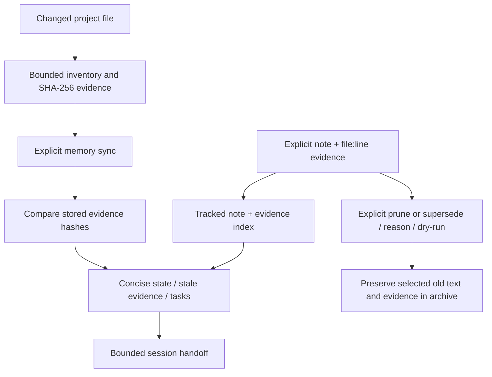

# Data flows and memory

The [registry](skill-registry.md), [usage](usage-pipeline.md),
[pack](provider-adapters.md) and [specification](orchestration.md) diagrams
describe their implemented flows. The CLI performs no network operations during
ordinary initialization, reports, specifications, evaluations or packaging.
Explicit GitHub skill resolution and opt-in loopback Ollama are separate network paths.

Project memory remains the existing evidence-index implementation:

`memory sync --deep` explicitly regenerates deeper explanation; it is not triggered
by every quick sync. Model proposals never overwrite authoritative memory.
Existing evidence hashing and reports remain intact. No new memory store, remote
index or inferred runtime architecture was introduced.

Current project explanation uses Python AST imports and labeled JS/TS lexical
import heuristics. It does not resolve arbitrary function calls, runtime dependency
injection or database flows. Tree-sitter, ast-grep, repository-map ranking,
Repomix and GitNexus integration are reference decisions, not bundled functionality.
