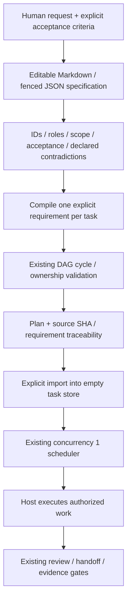
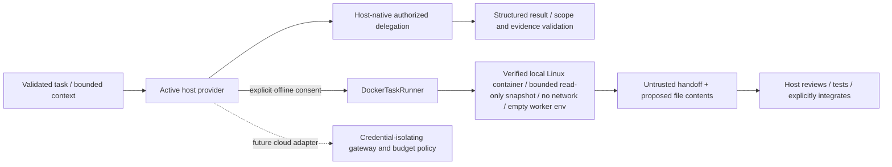

# Specifications and orchestration

The compiler does not infer requirements or call a model. `spec init` requires
the user's acceptance criteria and scope; the Markdown contains the authoritative
editable JSON block. Requirements list roles, claims and dependency requirement
IDs. Declared contradictions fail. Overlapping writers need an explicit ordering
dependency; missing roles/acceptance and cycles fail through the existing DAG.
Natural-language ambiguity and semantic contradictions still need human review.

`spec plan` previews; `--write` saves regenerable plan/trace files. `spec tasks`
previews the same plan; `--import` writes task state and source-hash trace together
under the existing project lock. Existing tasks are never replaced. Later spec
edits produce new hashes/proposals; they do not silently change active tasks.
`spec reconcile` explicitly previews and applies source/ownership/DAG-bound plans.
Only owned pending tasks without evidence can change or disappear. Unchanged task
state, handoffs and unrelated tasks survive; started requirements need follow-ups.
Local definition/generated-output edits stop the operation. One project lock and
recoverable batch cover the DAG, source trace and active definition hashes.
`spec evidence` explicitly maps acceptance strings to stored handoff test indexes.
Source/handoff hashes invalidate stale mappings; observations are host-reported,
not independently executed tests. Semantic matching remains human work.

Default concurrency remains 1. Opt-in safe-parallel schedules compatible readers;
writers are serialized. Claims are cooperative checks, not an OS sandbox.

`tasks test` separately records an explicitly authorized trusted host argv for a
running writer. It reuses this DAG, canonical definition hash, project lock and
managed receipt manifest; there is no second engine or automatic completion.
Selected source/executable hashes are checked before/after and on receipt reads.
Output/argv are hash-only; stale/failure is distinct from a current zero exit.
This host process has ordinary filesystem/network rights and no verified
descendant cleanup. Local records do not authenticate execution or acceptance.
See [test receipts](../guides/test-receipts.md) for the exact bounds and exclusions.

Execution boundary (offline worker implemented; cloud adapter remains planned):

Native delegation remains the host's responsibility. `tasks sandbox` runs a
trusted, preinstalled digest-pinned worker only after explicit consent. It requires
a running task in the existing DAG and holds the project writer lock, serializing
CLI workers. Only explicit in-scope, secret-filtered files become a temporary JSON
snapshot; the project, provider home and Docker socket are never mounted. No worker
environment is inherited. Actual daemon mount/network/resource configuration is
verified before execution. Read-only root, non-root UID, dropped capabilities,
no network, memory/PID/tmpfs bounds and forced container removal apply. Output is
a bounded untrusted JSON proposal; no files or task states are applied automatically.
The boundary requires local Linux Docker (including Docker Desktop); it fails
closed for remote daemons/Windows containers, absent images and cleanup failures.
Docker shares a kernel and trusts its daemon/host admin. Windows/macOS/Linux host
verification is separate; only Windows Docker Desktop was exercised locally.
Cloud Codex/Claude workers remain refused until credential-isolating network/cost
controls exist. Provider version/help probes and static validation are separate
from model execution. Changing cwd or adding prompts is insufficient.
There is no automatic fallback to another provider or recursive delegation.

`eval native-smoke` is a separate network-disabled protocol fixture, not task
delegation. It supplies no user task/project files, only a fixed synthetic response
and canonical first-party plugin. Claude's optional one-case native regex eval
remains mock evidence; it does not complete DAG tasks or establish model quality.
See [native probes](native-probes.md).
