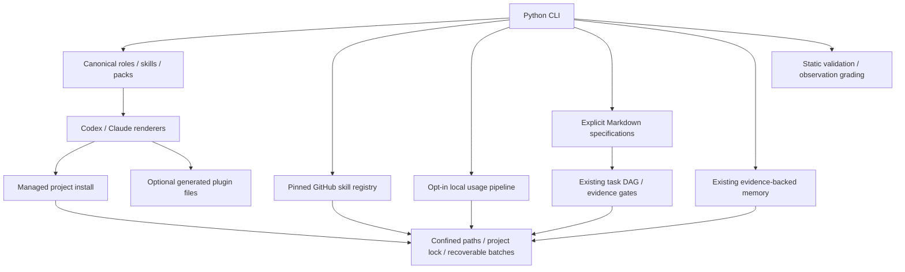

# AgentBase architecture

The dependency-free Python CLI performs deterministic coordination. It does not
host inference or control native agent sandboxes. Existing flat modules remain;
new modules extend them without a competing registry, task engine or memory store.

`catalog.py` loads packaged first-party definitions. `packs.py` selects these
definitions. `registry.py` owns third-party installation provenance and hashes;
the core installation manifest continues to own only first-party files.
`usage.py` stores allowlisted measurements, not conversations. `specs.py`
compiles explicitly authored requirements; `evaluation.py` validates or grades
provided observations; `distribution.py` renders local plugin packages.

An agent is a role, a skill is an on-demand workflow, a pack selects catalog
entries, a plugin distributes native resources, a provider adapter renders them,
and a workflow orders tasks. None implicitly grants tool or filesystem access.

Supported today: [registry](skill-registry.md), [usage](usage-pipeline.md),
[orchestration](orchestration.md), [adapters](provider-adapters.md), [flows](data-flows.md).
Structural facts now use per-file hashes and current-inventory import resolution;
feature queries remain lexical and calls remain explicitly unverified candidates.
Ollama proposals use installed-model metadata preflight and structured validation.
An explicit offline deterministic Docker worker now returns untrusted structured
proposals without host file integration. Cloud cross-provider runners and live
model evaluations remain future work; see [status](../development/STATUS.md).
The [credential gateway](provider-gateway.md) is implemented and tested with dummy
keys and zero valid API calls. Production native worker/eval integration remains disabled.
Separate [native image probes](native-probes.md) now verify version/help contracts,
synthetic API decoding, Claude canonical plugin discovery and a one-case native
regex eval inside a network-disabled container. Reports explicitly label mock
origin; real model behavior and production worker integration remain unverified.
