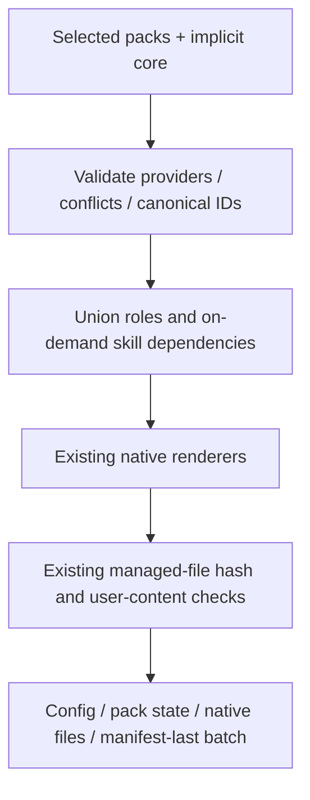

# Provider adapters and distribution

First-party roles and skills remain in `assets/roles.json` and `assets/skills`.
Pack selections filter `adapters.render`; dependency skills of selected roles
are included once per native discovery target. `init` without `--pack` preserves
the existing full catalog behavior. `init --provider both` remains supported.

Seven versioned packs ship: core, web, python, ai-ml, security, devops and
documentation. They select existing capabilities; they do not install tooling,
load every skill into context or guarantee specialized behavior in a live model.
Recommendations use local filenames only. `packs register --file` validates a
custom manifest in the same format and registers a selection of known canonical
roles/skills, without executing code or installing it. IDs cannot shadow bundled
packs. Custom manifests live in `.agentbase/pack-catalog`; install explicitly
with `init --pack` or `packs add`. Adding a pack to a legacy full-catalog installation retains
that full catalog; removing the selection does not remove inherited content.
Pack upgrades happen through `agentbase update` after reviewing its dry-run.

`plugins build` renders a reproducible local distribution without publishing.
Claude gets `.claude-plugin/plugin.json`, a local marketplace, native agents
and skills. Codex gets portable root `plugin.json`, an optional compatibility
`.codex-plugin/plugin.json`, and one skills directory. Codex custom-agent plugin
discovery is not asserted; standalone agents remain provided through init.
Every package includes the MIT license and a hash inventory. Differing output
files are preserved; regenerate upgrades into a new directory. `plugins validate`
checks exact canonical files, metadata and inventory, not host certification.

The Python CLI must be installed separately for task/memory/context workflows.
Use `init --discovery plugin` when installing the native plugin: it creates CLI
state/policy/instructions, omits duplicate bundled skills and Claude agents, and
retains standalone Codex agents because plugin-agent discovery is not established.
For an existing project preview `update --discovery plugin --dry-run`, then apply;
the existing hash checks preserve edited managed files. `update --discovery native`
returns to standalone generation. Default init remains native. Plugin discovery
mode does not itself install a plugin or check its activation. No hooks,
MCP servers, commercial API dependency or marketplace publication are added.

Sources checked 2026-11-10:
[OpenAI plugin packaging](https://developers.openai.com/plugins/build/plugins),
[Claude manifest](https://code.claude.com/docs/en/plugins-reference).
Installed versions observed: Codex 0.167.0-alpha.3.2, Claude Code 2.1.310.
The Claude native plugin validator was run; real skill/agent activation was not.
Claude `plugin eval --help` confirms availability locally; evaluation starts
model sessions and was not run. AgentBase offers offline static validation and
grading supplied observations instead. Mock/manual/provider-capture origins
are explicit; supplied observations are not independently authenticated runtime evidence.

2026-11-14 additions: `eval capabilities --provider PROVIDER --consent` runs only
trusted host executable version/help probes in a temporary directory with a reduced
environment. Project-local executables are refused. Feature detection records
the actual version and options, without inferring model/account availability.
`plugins validate --output PATH --native --consent` first checks exact canonical
integrity, then invokes a supported native static validator. Claude's validator
is supported; Codex's command contract is not invented if absent or unknown.
This neither installs nor activates a plugin. Native eval launch remains disabled;
Claude's launch-time cost threshold can overrun in-flight and is not a hard cap.
