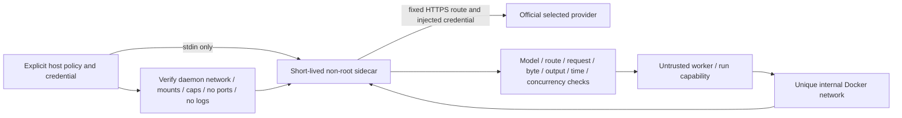

# Credential-isolating provider gateway

The optional gateway is implemented and locally tested. Native provider/eval
paid launch has not been enabled or verified. Separate [synthetic native probes](native-probes.md)
verify a narrow no-tools subset without external network or real keys. Python stays stdlib-only; the gateway
requires an explicitly trusted preinstalled digest-pinned Node 20+ Linux image.

`GatewaySession` owns one internal network and one sidecar, with verified removal
on normal/failing exits. Only the gateway joins the egress bridge. The worker gets
a random run-scoped capability; it never receives the upstream key, provider home,
host environment or Docker socket. Gateway bootstrap sends the key through a pipe,
never arguments, environment, mounted files, configuration, reports or logs.
Container logging is disabled. Temporary read-only mounts contain only first-party
program/schema assets. Root filesystem, UID, capabilities, memory, PIDs, network
membership and absent published ports are inspected before start.

The canonical policy lives in `assets/gateway-policy.json`. Both Python and the
sidecar validate it. `codex` selects the OpenAI Responses protocol/official host;
`claude` selects the Anthropic Messages protocol/official host. These labels do
not mean a Codex/Claude Code session was started. There is no arbitrary upstream
URL, redirect, CONNECT, upgrade or remote-server configuration. Models/paths are
fixed per session. Hosted tools, remote image/file/audio inputs, stored context,
background requests and service-tier/speed changes are refused. Output is capped,
OpenAI storage disabled, client headers discarded and provider auth injected only
server-side. Provider-specific top-level request fields and client-tool definition
fields use explicit allowlists, including tools inside Codex namespaces. Unknown
fields, Claude remote MCP/container/context configuration and stored item/server-tool
references fail before transport, including null/false remote configuration fields.
Codex `client_metadata` is explicitly supported as metadata. This is a narrow field
contract, not a full validator for every nested provider value/schema; malformed
allowlisted values may still consume a request attempt and be refused upstream.
Attempted requests consume
budget even if the upstream fails. Concurrency is one.

JSON/SSE response bodies are bounded and buffered, literal key occurrences are
redacted across chunk boundaries, and upstream errors/headers are not relayed.
This protects against accidental literal credential echoes; a compromised provider,
Docker daemon, Node runtime or host administrator is outside this boundary. It is
not a general proxy, production network appliance, invoice cap or subscription
quota collector. Streaming is buffered until completion and some native beta/API
features are intentionally unsupported. No native activation claim is made.
The exact Claude `?beta=true` Messages query is accepted and removed at the fixed
upstream route. Codex tool namespaces may group bounded function/custom tools;
hosted tools and nested namespaces remain refused. This is not general beta/header
pass-through; the synthetic native fixture disables experimental betas/web search.

`gateway validate --file POLICY.json` is deterministic. `gateway self-test --image
TRUSTED_PIN --consent` creates only local disposable resources and uses a synthetic
key. Nine boundary observations, zero upstream attempts, process lifetime expiry
and resource removal are checked. `scripts/gateway_smoke.py --docker --image ...`
calls the same implementation. Standard tests use fake HTTPS transport and local
HTTP; no credentials/accounts/model calls. Node is optional and its test is skipped
if unavailable. Real upstream compatibility/spending remain separately authorized.
