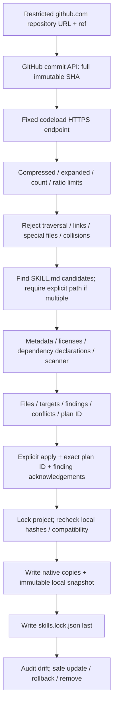

# Secure GitHub skill registry

Only public `https://github.com/owner/repository` sources are supported. No
credentials, arbitrary fetch hosts, redirects, Git subprocesses, submodules or
extraction. ZIP entries are read into bounded memory. Limits: 20 MB compressed,
32 MB expanded, 2 MB per file, 2000 entries, maximum ratio 200:1. Large valid
repositories can be rejected; use a dedicated skill repository instead.

Each selected skill gets one record in `.agentbase/skills.lock.json`: source,
requested ref, SHA, subdirectory, UTC install time, metadata, license inventory,
dependency declarations, findings, targets and SHA-256 inventory. Native copies
live under `.agents/skills` and/or `.claude/skills`; rollback snapshots under
`.agentbase/registry/<id>/<commit>`. Five previous installation records are kept.
Lockfiles are bounded below the existing JSON reader's 4 MB limit.

Default add/update/rollback/restore only produce a review plan. Applying requires
the exact plan ID, so a moving upstream ref invalidates review. Each high-severity
finding needs its own acknowledgement. No force flag bypasses review; unsafe
paths and executable binaries are unconditionally rejected. Installing a script
requires acknowledging its inclusion but never runs it. Host permissions still
govern any later execution by an agent.

Updates and removals reject missing, modified or untracked installed files.
Rollback verifies cached bytes and reruns the current scanner before writing.
Export prints the lock; restore accepts 1..100 entries, stages every immutable
source (96 MB aggregate staged limit), and rechecks inventory/compatibility/findings.
One aggregate review ID and all high-severity acknowledgements protect a single
recoverable batch. Any source failure/conflict/local edit prevents partial success.
Unrelated installations survive. Repeated identical restores retain install time
and rollback history; the exported requested ref survives the immutable refetch.
Core `uninstall --purge` refuses while third-party skills remain installed, so
their provenance cannot be discarded while leaving native copies orphaned.
Remove those skills explicitly before purging state.

The dependency-free metadata parser supports plain/quoted string fields,
two-space metadata string mappings and literal/folded block strings. It rejects
unsupported YAML constructs instead of guessing. It implements a conservative
subset of the Agent Skills YAML standard, not every valid YAML document.
The optional `yaml` extra and explicit `--yaml-parser pyyaml` select SafeLoader
composition for broader syntax. Metadata remains a shallow string mapping;
aliases/anchors/explicit tags/duplicate keys and frontmatter above 64 KiB fail.
No mandatory dependency or automatically selected parser is added.
Provider/dependency declarations use JSON arrays encoded as standard metadata
string values: `agentbase-providers` and `agentbase-dependencies`. Undeclared
provider compatibility means a format target, not runtime certification.

Root and ancestor LICENSE/LICENCE/COPYING/NOTICE/AUTHORS files are preserved in
`source-notices/`. Common licenses are heuristically identified; multiple,
restricted or unknown license texts remain unresolved. A metadata label alone
does not establish licensing. Findings include severity, file, bounded evidence
and recommended action. A clean scan means only that implemented checks found
no issue. Dependency presence checks recognize `tool:NAME`, `python-dist:NAME`,
`skill:ID`; unknown free text stays unknown. Tools are neither executed nor imported,
and no dependency is installed. Presence does not establish capability compatibility.

Search covers first-party packaged/local entries and packaged curated source links.
Community catalogs are [discovery references](../decisions/reference-audit.md), not reviewed
or automatically ingested remote indexes. First-party names are reserved.

Per-file writes are atomic and ordinary I/O failures roll back through `fs.py`.
This is not a power-failure transaction across files: lock-last hashes expose
drift after a crash. Inspect and preserve drift before manually restoring files;
there is no automatic crash journal replay.
Ordinary failed batches remove only empty directories they created, preserving
preexisting directories and allowing a retry after rollback.
