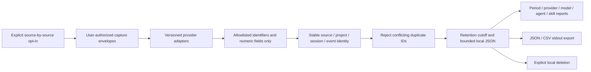

# Usage pipeline

No provider connection is established. Users capture supported messages through
their authorized integration and import an envelope with schema_version 1,
source, provider_version, timestamp, project_id, session_id, event_id and event.
The envelope records capture context rather than pretending every provider
message contains timestamps, model IDs or project identity.

Adapters:

| Source | Payload | Semantics |
| --- | --- | --- |
| `codex-exec-v1` | `turn.completed` JSON event | Per-turn counters; model may remain unknown |
| `codex-app-server-v1` | `thread/tokenUsage/updated` notification | Cumulative `tokenUsage.total`; differences only after a known prior observation |
| `claude-api-request-v1` | Decoded OTel `api_request` attributes object | Per-request counters and estimated API cost; full OTLP transport is not parsed |
| `claude-statusline-v1` | Statusline JSON object | Context occupancy and cumulative estimated session cost/duration, **not consumed token totals** |

Missing metrics remain null. Negative/invalid numbers fail. First cumulative
samples and counter resets yield unknown deltas. Repeated event identities are
deduplicated; conflicting values reject the entire import. Competing consumption
sources for the same session are excluded with warnings, while statusline context
can coexist with request measurements. Callers must reuse stable event IDs when
recapturing a Codex event; no protocol-independent turn ID is invented.

Token fields retain provider definitions: Codex input includes cached input;
Claude request input excludes cache reads/creation (separate fields). Compare
the breakdowns rather than summing unlike counters. Cached and reasoning tokens
can be subsets of other counters, so fields must not be blindly added together.
Cross-day snapshot deltas remain explicitly unallocated in daily reports; intervals
crossing a selected period's start also remain unknown in its totals. Retained
aggregate totals can include measured interval deltas. Raw snapshots
remain available in export. Reports show known subtotals and unknown counts.

Agent/skill attribution comes only from an explicit `agentbase_correlation`
contract (matching both endpoints for cumulative deltas), or non-redacted Claude request `agent.name` / `skill.name` attributes.
Generic `custom`/`third-party` labels remain unattributed. No session-total token
allocation is fabricated. Costs stay estimates; billed amounts and subscription
remaining quota stay unavailable. No automatic pricing lookup or claimed savings.

Storage: `.agentbase/usage/{config,records}.json`, ignored by this repository's
Git rules. New stores use POSIX owner-only permissions; Windows inherits the
project ACL, which operators must protect. Do not use a shared/public checkout
for private identifiers. Export contains allowlisted records only, with no raw
prompt, environment, tool output or code. `usage capture` accepts one documented
stdin event only after source opt-in; normalized snapshot fingerprints deduplicate
repeated observations. Incremental captures require stable caller-supplied event
identity. It never edits native settings, opens logs or launches a provider.
Collection is explicit import or user-connected stdin capture only;
configure with no sources disables all imports. Disabled sources are hidden in
reports/export but retained until deletion or retention pruning.

Retention defaults to 30 days, is configurable, prunes on import, and hides expired
records at report/export time. There is no background collector or scheduler.
UTC works without timezone data; local uses the machine offset. Named IANA zones
require installed system timezone data (or the optional `tzdata` package).
For historical daylight-saving boundaries use an IANA zone rather than local's
fixed current offset. All stored timestamps are timezone-aware UTC.

Sources checked 2026-11-10:
[Codex JSON output](https://learn.chatgpt.com/docs/non-interactive-mode),
[App Server events](https://learn.chatgpt.com/docs/app-server),
[Claude request attributes](https://code.claude.com/docs/en/monitoring-usage),
[Claude statusline](https://code.claude.com/docs/en/statusline).
Codex 0.167.0-alpha.3.2 locally generated the App Server JSON schema confirming
the adapter's camelCase fields. These adapters have fixture tests; no live model
usage event was generated in this development session.
